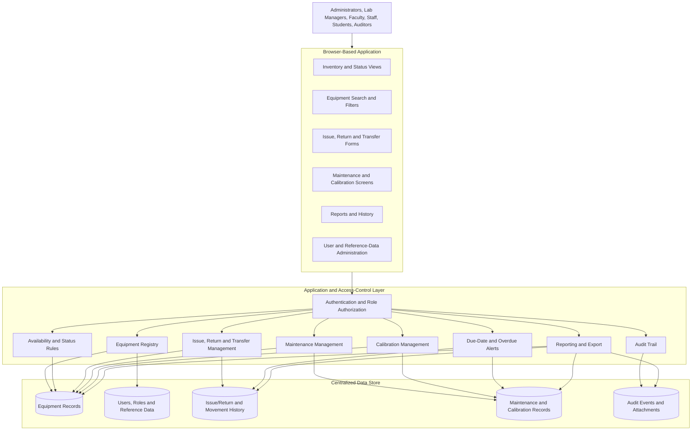
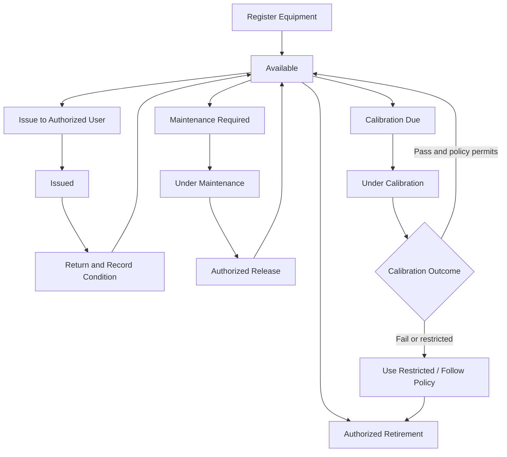

# Laboratory Equipment Management System (LEMS)

> **A centralized way to register, track, maintain, calibrate, and manage laboratory equipment throughout its lifecycle.**

The **Laboratory Equipment Management System (LEMS)** is a proposed browser-based application for educational institutions, research organizations, and industrial laboratories. It is intended to replace scattered paper registers and spreadsheets with a centralized source of truth for equipment records, availability, responsibility, issue/return activity, maintenance, calibration, and history.

LEMS is designed around role-based access, traceable transactions, controlled equipment statuses, timely reminders, and reports that help laboratory stakeholders understand how equipment is being used and maintained.

> **Project status:** This README describes the proposed system based on the project statement and Software Requirements Specification (SRS). The supplied documents do not define an implementation stack, repository layout, or executable setup commands, so those details should be added once the implementation is selected.

---

## Contents

- [1. Problem Statement](#1-problem-statement)
- [2. Goals and Scope](#2-goals-and-scope)
- [3. System Architecture](#3-system-architecture)
- [4. Core Features and Workflows](#4-core-features-and-workflows)
- [5. User Roles and Permissions](#5-user-roles-and-permissions)
- [6. Equipment Status Lifecycle](#6-equipment-status-lifecycle)
- [7. Main Records and Data](#7-main-records-and-data)
- [8. Functional Requirements](#8-functional-requirements)
- [9. Non-Functional Requirements](#9-non-functional-requirements)
- [10. Standards and Development Approach](#10-standards-and-development-approach)
- [11. Setup and Implementation Notes](#11-setup-and-implementation-notes)
- [12. Verification and Acceptance Checklist](#12-verification-and-acceptance-checklist)
- [13. Constraints and Open Decisions](#13-constraints-and-open-decisions)
- [14. Future Scope](#14-future-scope)

---

## 1. Problem Statement

Laboratories often use manual registers, paper forms, or disconnected spreadsheets to maintain equipment information. These approaches make it difficult to answer basic operational questions reliably:

- What equipment is available, and where is it located?
- Who is using or responsible for a particular item?
- Is an item issued, damaged, under maintenance, or under calibration?
- When is the next maintenance or calibration due?
- What is the complete history of equipment usage, servicing, and movement?
- Which equipment is unavailable, obsolete, or potentially due for replacement?

The resulting gaps can cause duplicate or incomplete records, misplaced equipment, missed service dates, inefficient resource use, and additional administrative work. LEMS is proposed to address these issues through structured records, controlled transactions, reminders, and reporting.

## 2. Goals and Scope

### Goals

1. Maintain a centralized and searchable equipment inventory.
2. Track equipment availability, location, custodian, and responsibility.
3. Record equipment issue, return, and movement between users or locations.
4. Schedule and document preventive and corrective maintenance.
5. Maintain calibration dates, service details, certificates, and due-date alerts.
6. Protect system operations through authentication and role-based authorization.
7. Preserve transaction history and significant record changes for accountability.
8. Provide useful inventory, usage, maintenance, calibration, and availability reports.

### Included in the proposed scope

- Equipment registration, updates, search, and retirement
- Availability and status management
- Issue, return, and transfer tracking
- Maintenance and calibration records
- Overdue and upcoming-due notifications or alerts
- Audit trail and reporting
- User, role, category, location, and department administration
- Controlled data import and document attachments where supported by the implementation

### Not guaranteed by the system

LEMS supports operational recordkeeping. The application by itself does **not** certify a laboratory or guarantee regulatory compliance. Any standards mentioned in this README are reference frameworks, not a claim of certification or compliance.

---

## 3. System Architecture

The following diagram shows a **logical proposed architecture**, not a claim about an already implemented technology stack.

### Architectural principles

- **Centralized records:** equipment and its operational history should be accessible from a common system of record.
- **Authorization at the server:** hiding a screen or button is not a substitute for checking permissions on the server.
- **Controlled status transitions:** issue and maintenance operations must respect the item's current status and applicable policy.
- **Traceability:** important changes and transactions should record the actor, timestamp, affected record, and action.
- **Data integrity:** asset identifiers must be unique, and references, dates, and transactions must be validated.

---

## 4. Core Features and Workflows

### 4.1 Equipment Registration and Inventory

Authorized users can create, update, search, and retire equipment records. Each item has a unique asset ID and relevant identification, location, status, responsibility, purchase, and warranty information.

Typical fields include:

- Asset ID and equipment name
- Category, manufacturer, model, and serial number
- Purchase date and warranty details
- Location, laboratory or department, and custodian
- Current status
- Related issue/return, maintenance, calibration, and history records

### 4.2 Search and Availability

Users can search or filter equipment by asset ID, name, category, location, serial number, or status. Results should clearly distinguish available equipment from issued, restricted, damaged, or retired equipment.

### 4.3 Issue, Return, and Transfer

The system records the recipient, issuer, issue time, expected return, return time, condition, and equipment movement. It should prevent multiple active issues for non-shareable items and identify overdue returns. Transfers should preserve the movement history and update the responsible location or custodian as appropriate.

### 4.4 Maintenance Management

Authorized users can record preventive or corrective work, service provider, service dates, outcome, next due date, and supporting documents. Equipment under maintenance must not be available for issue until an authorized user releases it.

### 4.5 Calibration Management

Calibration records include the calibration date, next due date, provider, certificate reference or file, and outcome. The system flags upcoming and overdue calibration. Failed or overdue calibration restricts equipment use when required by the approved institutional policy.

### 4.6 Notifications and Audit Trail

The system surfaces overdue returns and upcoming or overdue maintenance and calibration. Significant record changes and transactions are logged with the actor, timestamp, affected record, and action. Ordinary users must not be able to alter audit entries.

### 4.7 Reports

Authorized users can generate reports for:

- Equipment inventory and availability
- Equipment issue and overdue returns
- Maintenance activity and due dates
- Calibration activity and due dates
- Individual equipment history and movement

CSV/PDF export may be provided depending on the implementation.

### 4.8 Administration

Administrators manage user accounts, roles, categories, locations, and departments. Controlled CSV import and document attachments may be supported where included in the implementation scope.

### Typical equipment lifecycle

The diagram is illustrative. Exact status-transition rules, including when failed or overdue calibration blocks use, must be approved by the laboratory or institution.

---

## 5. User Roles and Permissions

LEMS uses role-based access control. The detailed role-permission matrix must be approved before implementation.

| Role | Primary responsibilities |
|---|---|
| **Administrator** | Manage users, roles, configuration, reference data, and system operations. |
| **Lab Manager / Custodian** | Manage equipment, issue/return, transfers, maintenance, calibration, and reports. |
| **Faculty / Staff** | Search equipment and perform permitted requests or transactions. |
| **Student / Authorized User** | View permitted equipment information and their own issue/return records. |
| **Auditor / Read-only** | Review authorized records, reports, and audit history without editing. |

### Access-control expectations

- Authentication and server-side role authorization are mandatory.
- Users may perform only operations allowed by their approved permissions.
- Audit records must not be editable by ordinary users.
- Equipment under maintenance, and equipment restricted by applicable calibration policy, must not be issued.
- Personal-data access and retention must follow institutional policy.

---

## 6. Equipment Status Lifecycle

The SRS defines the following principal equipment statuses:

| Status | Meaning / expected handling |
|---|---|
| **Available** | Equipment is available for permitted use or issue. |
| **Issued** | Equipment is currently issued; return details and due date should be tracked. |
| **Under Maintenance** | Maintenance is in progress; the item must not be issuable until an authorized release. |
| **Under Calibration** | Calibration is in progress; usage is controlled according to the approved policy. |
| **Damaged** | Equipment is recorded as damaged and should not be treated as normally available. |
| **Retired** | The item is retired from active use; its historical records must be retained. |

The exact transitions between statuses and handling of overdue or failed calibration must be finalized with the stakeholders. Status changes should be validated and recorded where significant.

---

## 7. Main Records and Data

The following is a conceptual data overview derived from the required features. It is **not** a finalized database schema.

| Record area | Representative information |
|---|---|
| Equipment | Unique asset ID, name, category, manufacturer, model, serial number, purchase date, location, status, custodian, warranty details |
| Users and roles | User account, assigned role, and approved permissions |
| Issue/return | Recipient, issuer, issue time, expected return, actual return, condition, and current or past movement |
| Maintenance | Preventive/corrective work, service provider, dates, outcome, next due date, supporting documents |
| Calibration | Calibration date, next due date, provider, certificate reference/file, outcome |
| Notifications | Overdue returns and upcoming or overdue maintenance/calibration events, subject to approved notification rules |
| Audit events | Actor, timestamp, affected record, and action for significant changes or transactions |
| Reference data | Categories, locations, departments, and other approved configuration values |

### Data-integrity rules

- Every equipment item must have a unique asset ID.
- Dates and references must be validated.
- Non-shareable equipment must not have duplicate active issues.
- Critical updates must be transactional.
- Equipment history must be retained after retirement.
- Audit entries must be protected from unauthorized modification.

---

## 8. Functional Requirements

This summary follows the requirement identifiers in the SRS.

| ID | Requirement | Expected capability |
|---|---|---|
| **FR-01** | Equipment records | Create, update, search, and retire equipment records with unique asset IDs and relevant equipment details. |
| **FR-02** | Search and availability | Filter by asset ID, name, category, location, serial number, or status; show defined equipment statuses. |
| **FR-03** | Issue, return, and transfer | Record issue/return details and equipment movement; prevent duplicate active issues for non-shareable items and identify overdue returns. |
| **FR-04** | Maintenance | Record service work and due dates; block issue while equipment is under maintenance until authorized release. |
| **FR-05** | Calibration | Maintain calibration details and certificates; flag due dates and restrict use when required by policy. |
| **FR-06** | Notifications and audit | Surface overdue/upcoming events and retain protected logs for significant changes and transactions. |
| **FR-07** | Reporting | Generate filtered inventory, availability, issue/overdue, maintenance, calibration, and equipment-history reports. CSV/PDF export may be provided. |
| **FR-08** | Administration | Manage user accounts, roles, categories, locations, and departments; controlled CSV import and attachments may be supported. |

---

## 9. Non-Functional Requirements

### Security

Authentication and server-side role authorization are mandatory. Production traffic should use HTTPS. Passwords and secrets must be protected, inputs validated, and secure logout and session expiry implemented according to approved policy.

### Performance

The SRS proposes the following baseline under agreed test conditions:

- At **10,000 equipment records** and **50 concurrent users**, 95% of normal searches should complete within **2 seconds**.
- Standard record updates should complete within **3 seconds**.

These are proposed targets, not measured or verified performance results.

### Reliability and recovery

Critical updates should be transactional. Backup and restore procedures must be documented and tested. Recovery Point Objective (RPO), Recovery Time Objective (RTO), backup retention, and availability targets require owner approval.

### Usability and maintainability

Forms should identify required fields and present clear validation messages. The interface should be accessible and responsive. The codebase should be modular, deployment should be documented, and automated tests should cover key behavior.

### Data integrity and privacy

Identifiers must be unique; dates and references must be validated; equipment history must remain available after retirement. Personal-data access and retention must follow institutional policy.

---

## 10. Standards and Development Approach

The project proposes a structured software life-cycle approach informed by **IEEE 1074** principles. The development process is expected to include:

1. Requirements analysis and validation
2. System architecture and database design
3. Implementation of the system modules
4. Verification and validation
5. Deployment
6. Maintenance and subsequent improvement

Requirements engineering and documentation may be aligned with **ISO/IEC/IEEE 29148**. **ISO 9001**, **ISO/IEC 27001**, and **ISO/IEC 17025** may be considered as relevant reference frameworks, depending on the institutional context. Mentioning these standards does not imply that LEMS is certified or automatically compliant with them.

---

## 11. Setup and Implementation Notes

The supplied project documents describe requirements and proposed behavior, but they do not specify the programming language, framework, database engine, repository structure, or dependency-management tools. For that reason, this README does not include unverified installation commands.

Before documenting a runnable setup, the implementation team should confirm:

- Backend and frontend technologies, if a separate frontend is used
- Database engine and migration approach
- Authentication and identity approach
- Required environment variables and secret-management method
- Installation and development-server commands
- Database initialization or seed-data process
- Test commands and deployment procedure

Once those choices are made, this section should document the prerequisites and exact commands to install dependencies, configure the environment, initialize the database, run the application, and execute tests.

---

## 12. Verification and Acceptance Checklist

The SRS states that all mandatory requirements must be verified or formally deferred before release. The following checklist summarizes important acceptance tests.

- [ ] Creating an equipment record requires a unique asset ID.
- [ ] Search and filters work for the supported identifiers, categories, locations, serial numbers, and statuses.
- [ ] Role restrictions prevent unauthorized operations on both the interface and server.
- [ ] Issue/return records preserve recipient, issuer, relevant timestamps, expected return, return condition, and movement history.
- [ ] The system prevents duplicate active issues for non-shareable equipment.
- [ ] Overdue returns are identified according to the approved rules.
- [ ] Equipment under maintenance cannot be issued until released by an authorized user.
- [ ] Upcoming and overdue maintenance/calibration events are flagged according to configured policies.
- [ ] Failed or overdue calibration restricts use where the approved policy requires it.
- [ ] Significant changes and transactions are written to the audit trail, and ordinary users cannot alter audit entries.
- [ ] Reports show accurate results for the selected filters and record types.
- [ ] Critical updates preserve data integrity when an operation fails.
- [ ] Backup restoration is tested successfully.
- [ ] Performance targets are tested under the agreed workload and environment.

The checklist is a starting point; detailed test cases, test data, and sign-off criteria should be maintained by the project team.

---

## 13. Constraints and Open Decisions

The following decisions need stakeholder approval before or during implementation:

- The detailed role-permission matrix
- Equipment categories and mandatory fields
- Calibration restrictions and handling of failed or overdue calibration
- Notification windows and delivery channels
- Hosting, identity, and authentication approach
- Expected workload and performance-test conditions
- Data-retention and privacy policies
- Backup retention, RPO, RTO, and availability targets
- Email service configuration, if email notifications are included
- Data mapping and quality checks for migration from legacy systems

Email notifications depend on an approved mail service. Migration depends on clean, mapped legacy data. QR/barcode support, mobile applications, single sign-on (SSO), email delivery, IoT monitoring, and predictive analytics are optional or future extensions unless explicitly approved for the initial release.

---

## 14. Future Scope

Potential extensions identified in the project documents include:

1. **QR and barcode identification** to make equipment lookup and movement recording faster.
2. **Mobile access** for staff working across laboratories or equipment rooms.
3. **Single sign-on (SSO)** to integrate with an approved institutional identity provider.
4. **Automated email notifications** for overdue returns and service/calibration deadlines, subject to an approved mail service.
5. **IoT-based equipment monitoring** for suitable connected instruments.
6. **Predictive analytics** to help analyze equipment utilization and support maintenance or replacement planning.

These are future or optional capabilities, not commitments for the initial release.

---

## Project Notes

- **Project name:** Laboratory Equipment Management System (LEMS)
- **Application model:** Proposed browser-based application with a centralized database
- **Primary purpose:** Equipment lifecycle tracking and operational recordkeeping
- **Source documents:** *Laboratory Equipment Management System Project Statement* and *Software Requirement Specification Document (SRS)*
- **License:** Not specified in the supplied project documents; add a license before public distribution if applicable.
